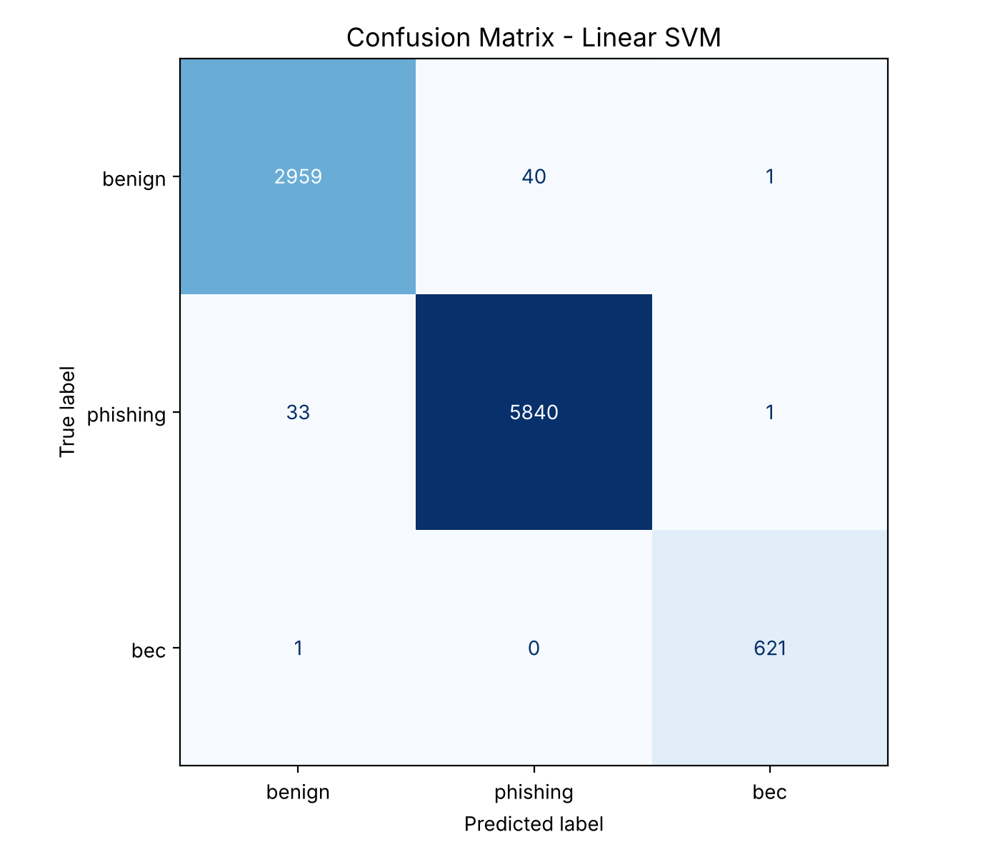
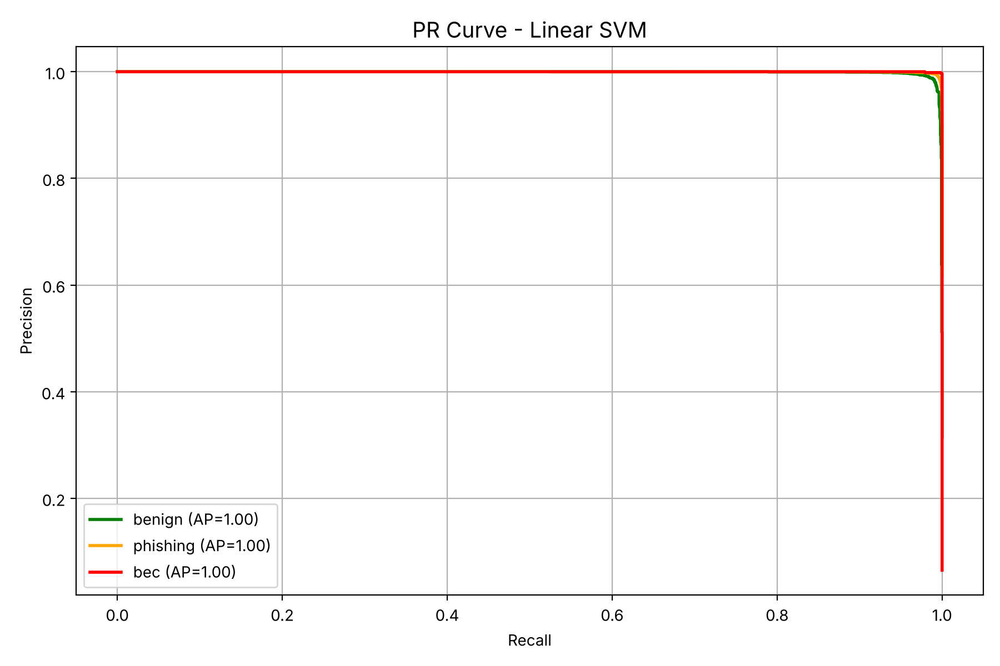

# Spam & BEC Email Detection

Phân loại email thành ba nhóm **Benign**, **Phishing** và **Business Email Compromise (BEC)** bằng Machine Learning.

Dự án môn AIC211 – Trường Đại học FPT.

## Bài toán

Phishing và BEC đều là tấn công qua email nhưng khác nhau về bản chất:

- **Phishing** thường để lại dấu hiệu kỹ thuật: đường link giả, tên miền nhái, yêu cầu đăng nhập.
- **BEC** thường không có link hay file độc. Kẻ tấn công giả danh lãnh đạo hoặc đối tác, dùng ngôn ngữ khẩn cấp để yêu cầu chuyển tiền hoặc gửi thông tin.

Vì BEC ít dấu hiệu kỹ thuật nên dễ lọt qua bộ lọc. Dự án ưu tiên đánh giá khả năng **không bỏ sót BEC** (BEC Recall), thay vì chỉ nhìn vào Accuracy tổng thể.

## Dữ liệu

63.305 email sau khi làm sạch:

| Nhãn | Số email |
|---|---|
| Phishing | 39.154 |
| Benign | 20.000 |
| BEC | 4.151 |

Dữ liệu mất cân bằng, BEC chỉ chiếm khoảng 6.5%. Vì vậy dữ liệu được chia train/val/test theo tỉ lệ 70/15/15 có `stratify`, và Linear SVM dùng `class_weight="balanced"`.

Dữ liệu được chia **trước** khi tạo TF-IDF: vectorizer chỉ học từ vựng và trọng số IDF trên tập train, còn tập val/test chỉ được transform. Cách này tránh data leakage, giúp kết quả trên tập test phản ánh đúng email mà mô hình chưa từng thấy.

## Pipeline

| Bước | File | Nội dung |
|---|---|---|
| 1 | `check_data.py` | Kiểm tra kích thước, cột, giá trị thiếu, phân bố nhãn |
| 2 | `preprocessing.py` | Chuẩn hóa nhãn, xử lý giá trị thiếu, làm sạch text (bỏ HTML, ký tự đặc biệt, stopwords) |
| 3 | `eda.py` | Phân bố class, word cloud theo từng nhãn, phân bố độ dài email |
| 4 | `feature_engineering.py` | Chia train/val/test, fit TF-IDF (unigram + bigram, 10.000 features) trên tập train, kết hợp metadata features |
| 5 | `train_models.py` | Huấn luyện 3 mô hình |
| 6 | `evaluate.py` | Confusion matrix, Precision-Recall curve, bảng so sánh mô hình |
| 7 | `error_analysis.py` | Phân tích BEC bị bỏ sót (false negative) và benign bị gắn nhầm thành BEC (false positive) |
| 8 | `test.py` | Dự đoán email mới trong `data/demo_emails.csv`, kèm các dấu hiệu giải thích kết quả |

### Metadata features

| Feature | Ý nghĩa |
|---|---|
| `url_count`, `has_url` | Số lượng và sự xuất hiện của đường link, đặc trưng của phishing |
| `has_urgency` | Có từ ngữ khẩn cấp như *urgent*, *wire transfer*, *confidential*, đặc trưng của BEC |
| `subject_length` | Độ dài tiêu đề |
| `free_email_sender` | Người gửi dùng email miễn phí (Gmail, Yahoo...), dấu hiệu giả danh thường gặp trong BEC |

## Kết quả

Đánh giá trên tập test gồm 9.496 email (622 BEC):

| Model | Accuracy | BEC Recall | BEC F1 |
|---|---|---|---|
| Naive Bayes | 0.9241 | 1.0000 | 0.7736 |
| **Linear SVM** | **0.9920** | **0.9984** | **0.9976** |
| XGBoost | 0.9825 | 0.9855 | 0.9871 |

**Mô hình được chọn: Linear SVM.** Mô hình này có Accuracy và BEC F1 cao nhất. Naive Bayes bắt được toàn bộ BEC nhưng F1 thấp (0.77), nghĩa là gắn nhãn BEC nhầm cho nhiều email khác, gây quá nhiều cảnh báo sai trong thực tế.

<p>
  
  
</p>

### Phân tích lỗi (Linear SVM)

| Nhãn thật → Dự đoán | Số email |
|---|---|
| benign → phishing | 40 |
| phishing → benign | 33 |
| benign → bec | 1 |
| phishing → bec | 1 |
| bec → benign | 1 |

- Phần lớn lỗi nằm giữa **benign và phishing**, không phải BEC.
- Chỉ **1/622 email BEC bị bỏ sót**: một email hỏi về khoản thanh toán $39.143 cho chương trình giáo dục, không có từ khẩn cấp, không có link và giọng văn giống email công việc bình thường. Đây đúng là kiểu BEC khó phát hiện nhất khi chỉ dựa vào nội dung.
- Chỉ 1 email benign bị gắn nhầm thành BEC.

## Hạn chế

- **Kết quả BEC cao bất thường** (F1 ≈ 0.998). Nhiều khả năng email BEC trong dataset có văn phong khá đồng nhất, nên mô hình dễ học. Kết quả trên email thực tế sẽ thấp hơn.
- Phiên bản đầu fit TF-IDF trên toàn bộ dữ liệu (data leakage). Sau khi sửa thành chỉ fit trên tập train, kết quả gần như không đổi (Accuracy 0.9915 → 0.9920), cho thấy leakage ở đây không làm sai lệch đánh giá.
- Metadata features còn đơn giản và dựa trên từ khóa tiếng Anh. Chưa kiểm tra header thật như `Reply-To` hay SPF/DKIM.

## Cách chạy

```bash
pip install -r requirements.txt

# Đặt dataset tại data/dataset.csv (cột: sender, subject, body, label)
python check_data.py
python preprocessing.py
python eda.py
python feature_engineering.py
python train_models.py
python evaluate.py
python error_analysis.py
python test.py
```

Dataset gốc (khoảng 106 MB) không được đưa lên repository vì vượt giới hạn dung lượng của GitHub.

## Công nghệ

Python · pandas · scikit-learn · XGBoost · NLTK · BeautifulSoup · matplotlib · seaborn
